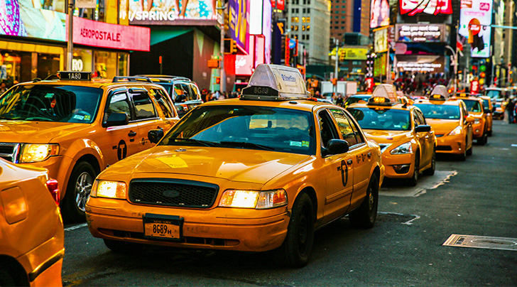
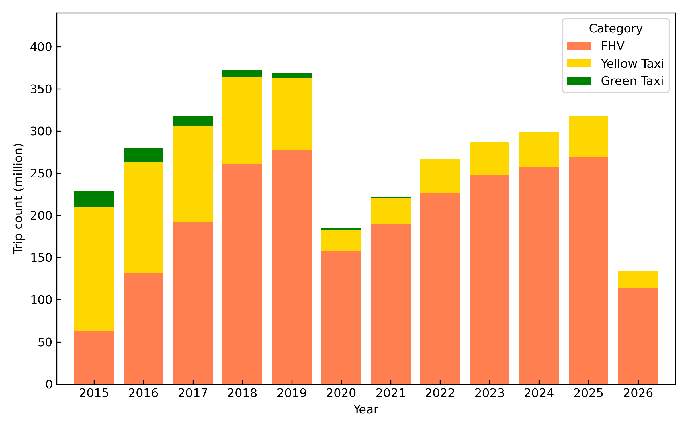
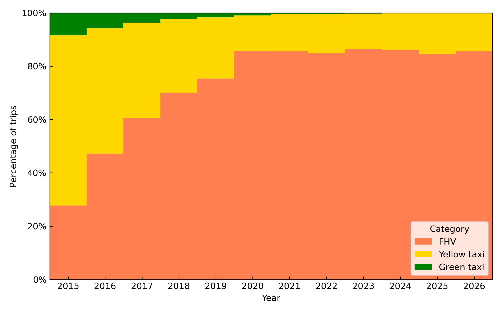
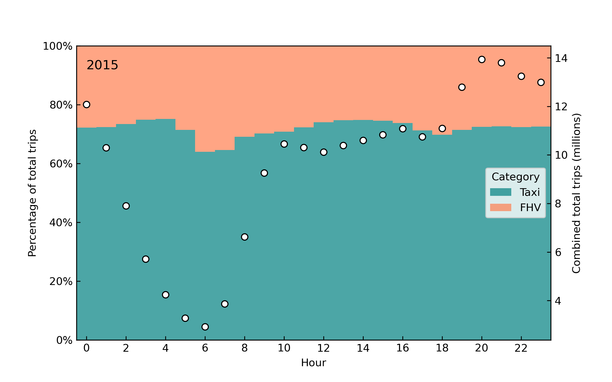
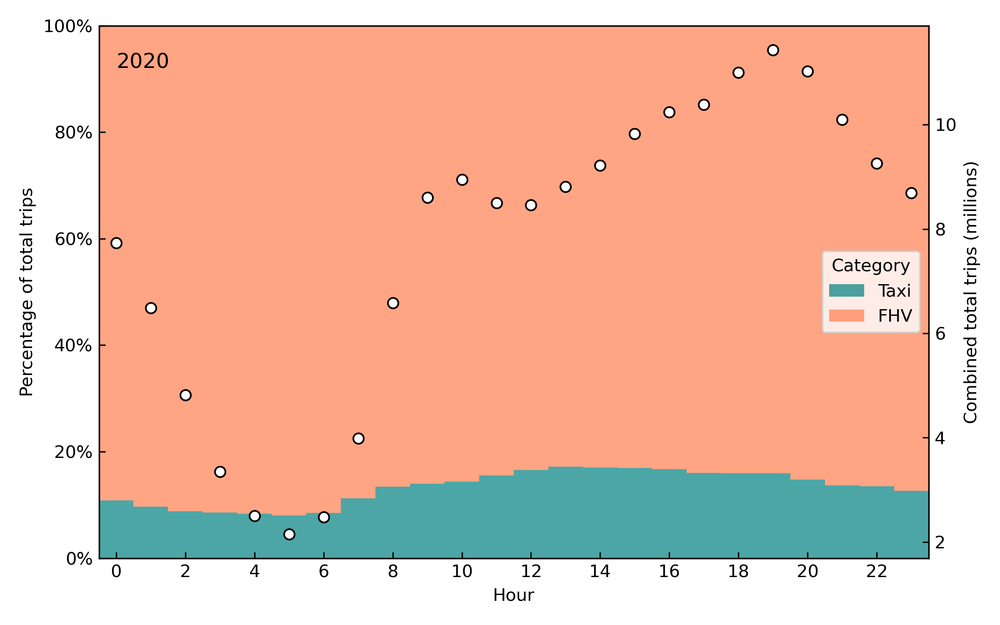
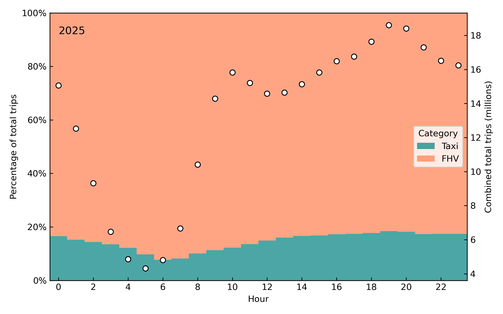

New York City (NYC) is the largest city in the United States by population. An iconic image of this city in the memory of many is a picture of many yellow cabs cruising through busy streets. 

This analysis investigates all NYC taxi trips from 2015 to 2026 using trip records published by 
 <a href="https://www.nyc.gov/site/tlc/about/tlc-trip-record-data.page">
    the NYC Taxi and Limousine Commission (TLC)
  </a>
. We are interested in changes in user behaviours and shifts in the industry over the last ten years, especially during the adoption of mobile applications and after COVID-19. This should provide insights to help the company make suitable adjustments to the business in the coming years to adapt to constant changes in the current economy.

The market has witnessed significant changes in the number of trips. As shown in Fig. 1, the total number of trips rose significantly from 2015 to 2019, increasing by over 60% from around 220 million to over 360 million trips in those five years. The market took a severe hit from COVID-19 in 2020, with a roughly 50% drop as city residents stayed at home to prevent the spread of the pandemic. Since then, the market has gradually recovered, reaching over 300 million trips in 2025, equivalent to 85% of the peak traffic in 2018.

*Figure 1: Heatmap showing trip counts by hour (y-axis) and year (x-axis)*

The market share has seen a shift between the types of providers: yellow taxi, green taxi, and for-hire vehicle (FHV) over the last decade (see Fig. 2). In 2015, over 70% of trips were with the traditional yellow and green taxi, in which a passenger hails a cab by waving at a nearby taxi. The FHV, in which vehicles are pre-arranged (for example, by ordering an Uber), accounted for around 30% of the market share then. The adoption of the fhv gradually increased its market share to a peak of 85% in 2020 and has been staying around that level for 6 years until now. It is unclear whether the expansion in the fhv's market share reached a saturation level at 85% in 2020 or the expansion trend was suspended by changes in user behaviours after COVID-19. Notably, the market share of green taxis has dropped to a critical level below 0.2% in 2025, questioning whether this taxi brand can continue to survive in the coming years. 

The hourly taxi demand displays two key aspects. First, the trend in taxi demand within a day remains the same over the last 10 years: high demand from around 10:00 to midnight, with a peak around 20:00, and low demand at night, with a lowest need for taxi around 5:00 and 6:00. However, the taxi demand in each hour still increases overall. For example, the taxi demand at the lowest volume hour (at 5:00 ot 6:00) increases from around 3 million trips in 2015 to 4 million trips in 2025, while the peak demand increases from 14 million to more than 18 million trips over the same time period. Unfortunately for the traditional taxi, the majority of that demand is now supplied by the FHV. 

